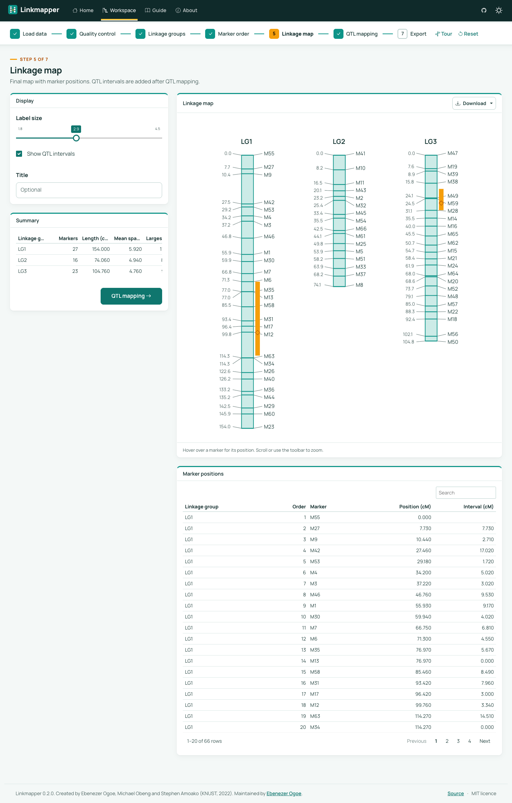
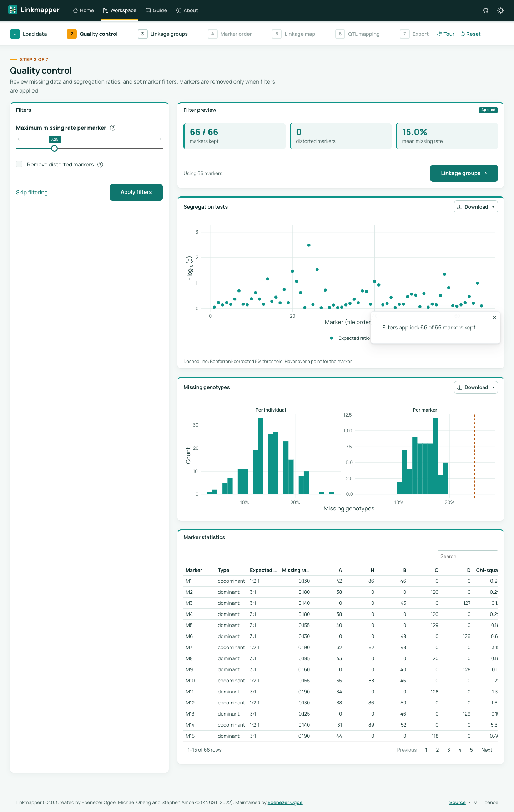
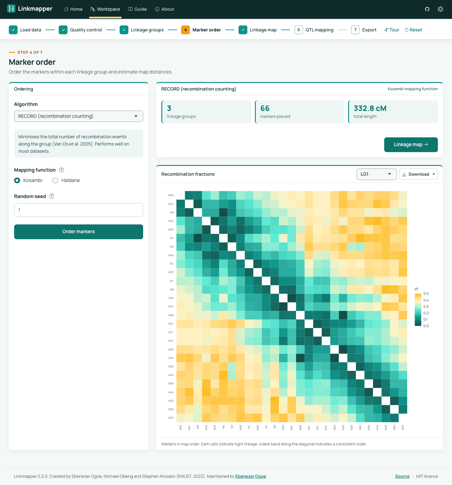
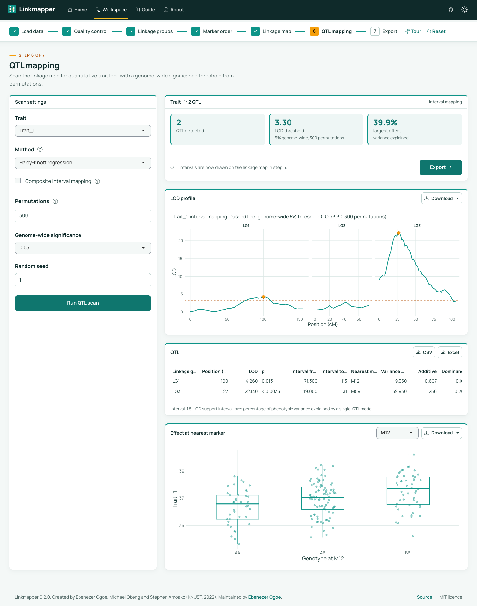
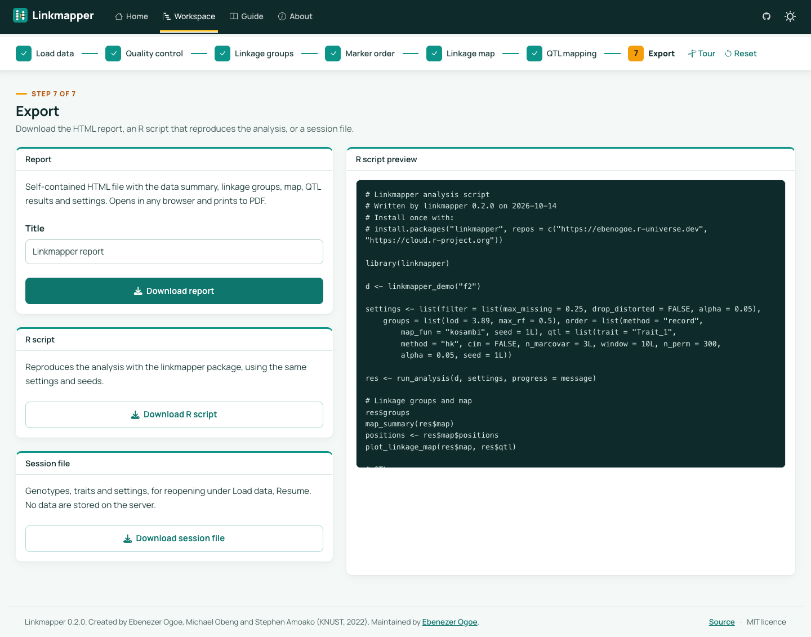

# Linkmapper

<!-- badges: start -->
[](https://github.com/ebenogoe/linkmapper/actions/workflows/R-CMD-check.yaml)
[](https://ebenogoe.r-universe.dev/linkmapper)
<!-- badges: end -->

Linkmapper builds genetic linkage maps and locates QTL in F2 intercross, backcross and recombinant inbred line populations, without code. It is a point-and-click interface to [onemap](https://cran.r-project.org/package=onemap) and [R/qtl](https://rqtl.org), with interactive maps, a report, and an R script that reproduces each analysis.

**Hosted app:** https://ebenogoe.shinyapps.io/linkmapper/



## Workflow

1. **Load data.** MAPMAKER or onemap raw genotype files, with traits in the file or from a separate CSV.
2. **Quality control.** Missing data per marker and individual; chi-square segregation tests with Bonferroni correction; marker filters.
3. **Linkage groups.** Two-point recombination fractions and LOD scores; grouping by LOD and maximum recombination fraction, with a suggested LOD threshold.
4. **Marker order.** RECORD, RCD, unidirectional growth or seriation; Kosambi or Haldane distances; recombination-fraction heatmaps per group.
5. **Linkage map.** Interactive map with positions and group summaries; PNG, SVG, PDF, CSV, Excel and MapChart exports.
6. **QTL mapping.** Interval mapping (Haley-Knott, EM or imputation) or composite interval mapping; permutation thresholds; 1.5-LOD support intervals, variance explained and effects.
7. **Export.** Self-contained HTML report, R script and session file.

## Accepted data formats

| Population | Header line | Genotype codes |
|---|---|---|
| F2 intercross | `data type f2 intercross` | A, H, B; C (not BB), D (not AA); `-` missing |
| Backcross | `data type f2 backcross` | A, H; `-` missing |
| RIL, selfing | `data type ri self` | A, B; `-` missing |
| RIL, sib mating | `data type ri sib` | A, B; `-` missing |

## Screenshots

| | |
|---|---|
|  |  |
|  |  |

## Installation

```r
install.packages("linkmapper", repos = c("https://ebenogoe.r-universe.dev", "https://cloud.r-project.org"))
linkmapper::run_app()
```

`run_linkmapper()`, `validate_lm_file()` and `group_markers()` from version 0.1 still work.

The analysis is also available as functions:

```r
library(linkmapper)
d <- read_cross("my_population.raw")
d <- filter_markers(d, max_missing = 0.25)
g <- linkage_groups(d)
m <- order_groups(g, "record")
r <- scan_qtl(build_cross(d, m), n_perm = 1000)
plot_linkage_map(m, r)
```

## Demo data

`linkmapper_demo()` loads the simulated F2, backcross and RIL examples shipped with onemap, and the 20-individual F2 file from the 2022 Linkmapper.

## History

Linkmapper was created in 2022 at the Kwame Nkrumah University of Science and Technology (KNUST) by Ebenezer Ogoe, Michael Obeng and Stephen Amoako. Version 0.2 (2026) is a rewrite as an R package with backcross and RIL support, R/qtl-based QTL mapping, an interactive map and reproducible exports. See `NEWS.md`.

## Citation

Run `citation("linkmapper")`, and cite onemap (Margarido et al. 2007; Taniguti et al. 2023) and R/qtl (Broman et al. 2003).

## Licence

MIT. Linkmapper was created by Ebenezer Ogoe, Michael Obeng and Stephen Amoako; the 2026 package was written and is maintained by Ebenezer Ogoe.
