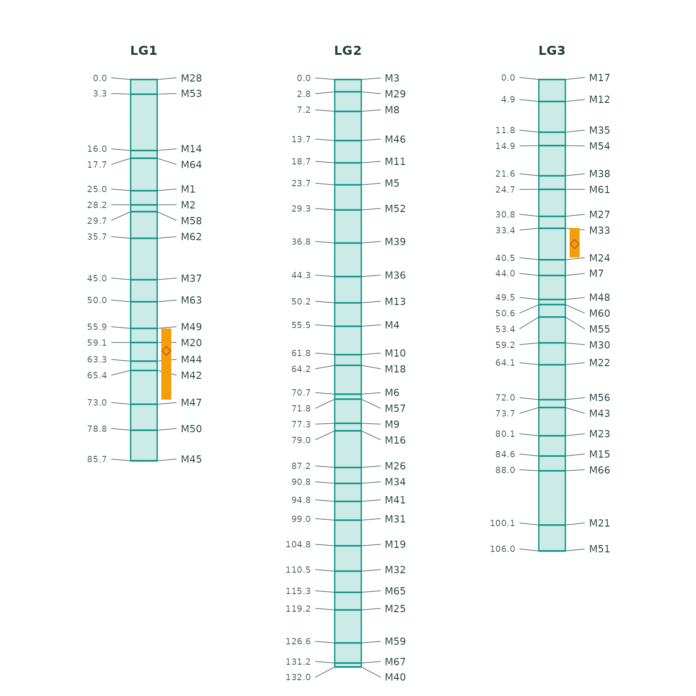

# Getting started

This article runs the app’s workflow in code, on the simulated backcross
example from onemap (150 individuals, 67 markers, one trait).

``` r

library(linkmapper)
d <- linkmapper_demo("bc")
d
#> <Linkmapper data>
#>   Population:  Backcross 
#>   Individuals: 150 
#>   Markers:     67 
#>   Traits:      1
```

## Quality control

``` r

q <- qc_summary(d)
q$n_distorted
#> [1] 0
d <- filter_markers(d, max_missing = 0.25)
```

## Linkage groups and marker order

``` r

g <- linkage_groups(d)
g
#> <Linkage groups> 3 groups, 0 unlinked markers
#>  group n_markers
#>      1        17
#>      2        28
#>      3        22
m <- order_groups(g, method = "record", map_fun = "kosambi", seed = 1)
map_summary(m)
#>    lg markers length_cM mean_spacing largest_gap
#> 1 LG1      17     85.70         5.36       12.65
#> 2 LG2      28    132.04         4.89        8.25
#> 3 LG3      22    105.97         5.05       12.19
```

## QTL mapping

``` r

cross <- build_cross(d, m)
r <- scan_qtl(cross, method = "hk", n_perm = 200, seed = 1)
r$peaks
#>    lg position   lod p_value interval_low interval_high nearest_marker   pve
#> 1 LG1       61 11.26       0         56.0            72            M20 29.24
#> 2 LG3       37 24.30       0         33.4            40            M24 52.58
#>   additive
#> 1    2.669
#> 2    3.594
plot_lod(r)
```



``` r

plot_linkage_map(m, r)
```



## Reproducing an analysis

Every setting the app records is a list that
[`run_analysis()`](https://ebenogoe.github.io/linkmapper/reference/run_analysis.md)
replays:

``` r

s <- default_settings(d)
s$qtl$n_perm <- 200
res <- run_analysis(linkmapper_demo("bc"), s)
identical(res$map$positions, m$positions)
#> [1] TRUE
```
